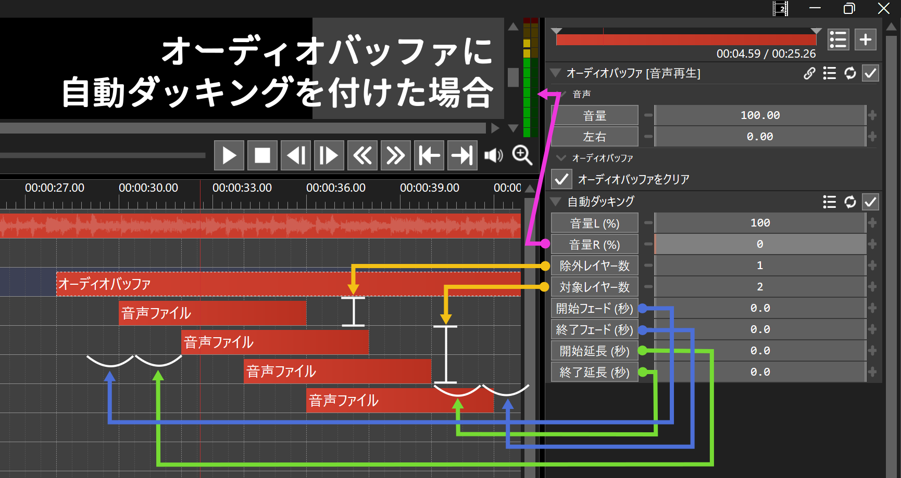

# 🐍AviUtl2 自動ダッキングプラグイン

* aviutl2のフィルタプラグインです。自動的にBGMの音量を下げることができます。

## 🚀インストール

* `プラグインフォルダ`に以下のファイルを入れてください。
	* `al2` ✏️フォルダ
		* `al2_audo_ducker.auf2` ✏️フィルタプラグインファイル

## 🔥アンインストール

* `プラグインフォルダ`から以下のファイルを削除してください。
	* `al2` ✏️フォルダ
		* `al2_audo_ducker.auf2` ✏️このファイルを削除

## 💡使い方

1. タイムラインで右クリックします。
1. `フィルタオブジェクトを追加`➡`音声効果`➡`自動ダッキング`を選択します。
	* または、 `フィルタ効果を追加`➡`音声効果`➡`自動ダッキング`を選択します。
	* または、音声オブジェクトにフィルタとして追加します。
1. 自動ダッキングオブジェクトがタイムラインに作成されます。
1. 自動ダッキングオブジェクトを音量を調整したい音声オブジェクトのすぐ下に配置します。
	* 複数の音声オブジェクトに適用したい場合は、`オーディオバッファ`を使用して1つの音声オブジェクトにまとめてください。
1. 自動ダッキングオブジェクトの下にダッキングのトリガーとなる対象オブジェクトを配置します。
1. 対象オブジェクトが存在する部分は、音声がダッキングされます。

## 🎨フィルタ項目

* `音量L (%)` ✏️調整後の左音量を%単位で指定します。
* `音量R (%)` ✏️調整後の右音量を%単位で指定します。
* `除外レイヤー数` ✏️自動ダッキングオブジェクトのすぐ下にあるレイヤーを除外する場合は、そのレイヤー数を指定します。
* `対象レイヤー数` ✏️自動ダッキングオブジェクトの下にある監視対象のレイヤー数を指定します。
* `開始フェード (秒)` ✏️開始フェードが始まる範囲を秒単位で指定します。
* `終了フェード (秒)` ✏️終了フェードが始まる範囲を秒単位で指定します。
* `開始延長 (秒)` ✏️対象オブジェクトの開始位置を延長します。マイナスにすると縮小します。
* `終了延長 (秒)` ✏️対象オブジェクトの終了位置を延長します。マイナスにすると縮小します。

## 🔖更新履歴

* 🔖r1 2026年11月04日
	* 🎉初版
